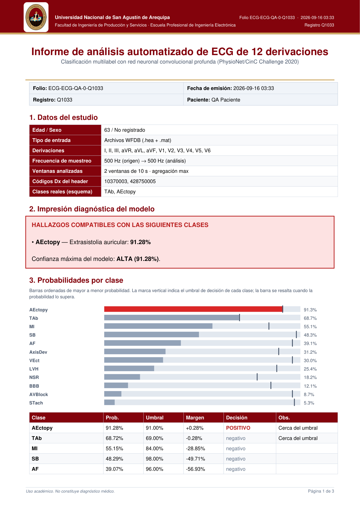

<a id="readme-top"></a>
<!--
*** Plantilla base: https://github.com/othneildrew/Best-README-Template
*** Submódulo: dashboard web Flask para análisis de ECG CINC2020-12.
-->

[![Python 3.10+][python-shield]][python-url]
[![Flask][flask-shield]][flask-url]

<br />
<div align="center">
  <a href="https://github.com/PatVela/Proyecto_Investigacion">
    
  </a>

<h3 align="center">Webapp ECG CINC2020-12</h3>

  <p align="center">
    Dashboard Flask bilingüe (ES/EN) para analizar ECG de 12 derivaciones
    <br />
    con el modelo multilabel, trazado en papel milimetrado e informe PDF.
    <br />
    <a href="../README.md"><strong>Volver al README principal »</strong></a>
    <br />
    <br />
    <a href="../examples/cinc2020/README.md">Ver pipeline</a>
    &middot;
    <a href="https://github.com/PatVela/Proyecto_Investigacion/issues/new?labels=bug">Reportar Bug</a>
    &middot;
    <a href="https://github.com/PatVela/Proyecto_Investigacion/issues/new?labels=enhancement">Pedir Funcionalidad</a>
  </p>
</div>

<details>
  <summary>Tabla de contenidos</summary>
  <ol>
    <li>
      <a href="#sobre-este-módulo">Sobre este módulo</a>
      <ul>
        <li><a href="#funcionalidades">Funcionalidades</a></li>
      </ul>
    </li>
    <li>
      <a href="#primeros-pasos">Primeros pasos</a>
      <ul>
        <li><a href="#prerrequisitos">Prerrequisitos</a></li>
        <li><a href="#ejecución">Ejecución</a></li>
      </ul>
    </li>
    <li><a href="#uso">Uso</a></li>
    <li><a href="#estructura">Estructura</a></li>
    <li><a href="#roadmap">Roadmap</a></li>
    <li><a href="#licencia">Licencia</a></li>
  </ol>
</details>

## Sobre este módulo



Aplicación Flask tipo dashboard: se sube un ECG, se analiza con el ensemble de dos modelos (o con el mejor checkpoint disponible en desarrollo) y se presenta el resultado con probabilidades por clase, comparación contra etiquetas reales, trazado ECG e informe PDF descargable. Incluye secciones de detalle técnico, métricas de evaluación y experimentos cuando existen archivos generados por el pipeline.

### Funcionalidades

* Carga por arrastrar/seleccionar archivo (CSV o par WFDB `.hea + .mat`).
* Conversión automática del par `.hea + .mat` a CSV preprocesado descargable.
* Ensemble de dos modelos con calibración por modelo; sin configuración se elige el mejor checkpoint de la carpeta `saved/`.
* Siete ECG de ejemplo incluidos (CC BY 4.0) para probar sin datos propios, y límites de uso público (tamaño, tasa por IP, borrado de subidas).
* Interfaz accesible: navegación por teclado, enlace para saltar al contenido, contraste AA en ambos temas, secciones direccionables por URL (`#upload`, `#vis`, `#det`, `#exp`) y carga diferida de las gráficas.
* Predicción multilabel con probabilidades, márgenes y umbrales por clase.
* Detección automática de los umbrales calibrados por la evaluación; respaldo global 0.5 si no existen.
* CSV sin unidades declaradas: se infieren (|valor| al percentil 99,9 > 20 → cuentas ADC ÷ 1000; si no, mV) y la ficha técnica muestra cuáles se asumieron.
* Registros de más de ≈ 20 s: hasta 4 ventanas de 10 s; cada una recorre la calibración completa y la probabilidad final es la **media** de las calibradas (con una ventana es la de esa ventana). Los umbrales se ajustaron con una ventana centrada: el máximo de varias ventanas añadía 85 falsos positivos (+20 %) en 1019 registros largos de test sin ganar F1.
* Trazado ECG con cuadrícula tipo papel milimetrado.
* Informe PDF profesional con membrete UNSA: veredicto, gráfico de barras y trazado.
* Comparación con etiquetas reales: automática desde `Dx` (WFDB) o manual para CSV (clases o SNOMED).
* Ficha técnica del registro y del modelo, esquema SNOMED-CT y métricas exportadas.
* Secciones de comparación arquitectónica y robustez alimentadas por los experimentos.
* Gráficas interactivas de métricas y curvas ROC/PR por clase (Plotly).
* Historial de análisis de la sesión con re-descarga de artefactos.
* Calibración automática si existe: temperatura por clase o calibración afín `a·logit + b` (la afín sustituye a la temperatura del mismo modelo; en un ensemble también se calibra el promedio).
* Interfaz bilingüe ES/EN con identidad UNSA (escudo, granate/dorado) y tema claro/oscuro persistentes.

<p align="right">(<a href="#readme-top">volver arriba</a>)</p>

## Primeros pasos

### Prerrequisitos

* Instalación base del proyecto (ver [README principal](../README.md#instalación)).
* Para desarrollo: al menos un checkpoint entrenado (`best.pt`) dentro de `saved/`. Para servir el bundle versionado basta `requirements.txt` (ver [Ejecución local](#ejecución-local-en-windows-11-sin-nube-ni-servidor)).

### Ejecución

Desde la raíz del proyecto; todo se configura con banderas. Defina los checkpoints una vez por terminal:

```powershell
$resnet = Get-ChildItem saved/cinc2020/cinc2020_resnet/*/best.pt | Sort-Object LastWriteTime -Descending | Select-Object -First 1 -ExpandProperty FullName
$resnet2 = Get-ChildItem saved/cinc2020/cinc2020_resnet_v2*/*/best.pt | Sort-Object LastWriteTime -Descending | Select-Object -First 1 -ExpandProperty FullName
```

Modo ensemble (modelo final recomendado): promedia dos checkpoints con calibración por modelo y usa los umbrales del directorio del ensemble (`ensemble-f1-platt` = umbrales F1 con calibración afín, el punto de operación de la demo; `ensemble-f1` = F1 con temperatura; `ensemble` = umbrales F0.5):

```powershell
python webapp/app.py --saved saved --eval-dir runs/eval/ensemble-f1-platt --exp-dir runs/reports --model $resnet --model-b $resnet2 --platt runs/eval/eval-resnet/platt_validation.csv --platt-b runs/eval/eval-resnet-v2/platt_validation.csv --platt-ensemble runs/eval/ensemble-f1-platt/platt_ensemble_validation.csv --port 5002
```

Abra http://127.0.0.1:5002 y pruebe con `E00001.hea + E00001.mat`. El servidor de desarrollo escucha solo en `127.0.0.1`; para abrirlo a la red local use `--host 0.0.0.0` (el lanzador de Windows lo hace con `-Lan`).

Con `--eval-dir` la app lee métricas, umbrales, temperaturas y curvas de esa carpeta; con `--exp-dir` lee la comparación de modelos y la robustez. Si se omiten, se buscan automáticamente.

Variantes:

```powershell
python webapp/app.py --saved saved
```

Deja que la app elija el mejor checkpoint automáticamente.

```powershell
python webapp/app.py --saved saved --eval-dir runs/eval/eval-resnet-v2 --model $resnet2
```

Un solo modelo (v2) con sus umbrales calibrados.

```powershell
python webapp/app.py --saved saved --thresholds runs/eval/eval-resnet-v2/thresholds_validation.csv
```

Si los umbrales calibrados están en una ruta no estándar, páselos explícitamente.

El fallback normal está **apagado por defecto**: las métricas que muestra la web (`evaluation_summary.json`, `normal_fallback_min_prob: null`) se calcularon sin él. Si quiere que, cuando ninguna clase supera su umbral y `P(NSR) >= 0.40`, la salida final añada `NSR` como postprocesamiento explícito (no cambia probabilidades ni pesos; en test afecta a 13 de 6421 registros, 7 NSR reales y 6 no, sin cambiar el F1), actívelo:

```powershell
python webapp/app.py --saved saved --normal-fallback-min-prob 0.40
```

Opcionalmente, entrada WSGI:

```powershell
python webapp/wsgi.py --saved saved
```

<p align="right">(<a href="#readme-top">volver arriba</a>)</p>

## Uso

### Formato CSV

Las 12 derivaciones estándar como columnas:

```text
I,II,III,aVR,aVL,aVF,V1,V2,V3,V4,V5,V6
```

Opcionalmente puede empezar con `# Sampling Rate: 500 Hz`; si no se indica, se asume 500 Hz. La frecuencia debe estar entre 50 y 10 000 Hz (fuera de ese rango se rechaza el archivo). Solo se aceptan `.csv`, `.hea` y `.mat`, hasta 2 archivos por solicitud y 5 MB en total. Para comparar contra etiquetas reales, use el campo opcional de la interfaz:

```text
NSR, AF
426783006,164889003
```

### Formato WFDB

Seleccione ambos archivos del mismo registro:

```text
A0001.hea
A0001.mat
```

La app valida que el stem coincida, lee el header, preprocesa la señal, compara predicción vs `Dx` y genera un CSV convertido descargable.

### Endpoints

| Método | Ruta | Descripción |
|---|---|---|
| `GET` | `/` | Dashboard (carga, resultado, detalle técnico, experimentos) |
| `POST` | `/predict` | Analiza archivos (o `example=<id>`) + umbral; devuelve JSON con probabilidades, trazado y PDF. 400 si el archivo no es válido (también si la señal dura menos de 2 s o está plana en más de 6 derivaciones: no se analiza lo que no es un ECG), 413 si pesa demasiado, 429 si se excede la tasa |
| `GET` | `/examples` | Lista de registros de ejemplo incluidos (id, origen, clases verdaderas y predichas de referencia) |
| `GET` | `/results/<archivo>` | Descarga artefactos generados (PDF, PNG, CSV convertido) |
| `GET` | `/models` | Checkpoints disponibles en la carpeta configurada (el cliente no puede elegir otra) |
| `POST` | `/use_model` | Cambia el checkpoint activo (vacío = selección automática). Solo acepta `.pt` dentro de la carpeta de modelos configurada. **Apagado por defecto** (403): cambia el modelo de todos los visitantes y la interfaz no lo usa; actívelo con `ECG_ENABLE_USE_MODEL=1` |
| `GET` | `/metrics` | Métricas de evaluación en JSON (si existen) |
| `GET` | `/experiments` | Comparación y robustez en JSON (si existen) |
| `GET` | `/curves?split=test` | Curvas ROC/PR por clase en JSON (si existen) |
| `GET` | `/health` | Estado del modelo, umbrales y calibración |

### Cómo se llenan las secciones de métricas y experimentos

Ejecute el pipeline de evaluación y experimentos (ver [examples/cinc2020/README.md](../examples/cinc2020/README.md#uso)); la webapp detecta automáticamente los CSV generados y completa las tablas, resúmenes de mejor/peor clase, ganador arquitectónico y caídas de robustez. La evaluación también calibra los umbrales por clase que la app usa en lugar del respaldo global 0.5, y exporta las curvas ROC/PR que alimentan los gráficos interactivos. Si existe calibración previa (`calibrate.py`), la app la aplica automáticamente: la afín `a·logit + b` (`platt_validation.csv`) o, si no hay, la temperatura por clase. Si sus carpetas tienen otros nombres, indíquelas con `--eval-dir` y `--exp-dir` (ver Ejecución).

<p align="right">(<a href="#readme-top">volver arriba</a>)</p>

## Ejecución local en Windows 11 (sin nube ni servidor)

La demo corre en la propia PC del autor; no hay servidor ni nube. Funciona **sin** las carpetas locales `saved/`,
`runs/` ni `data/`: todo lo que necesita está versionado en `models/`, `deploy/` y `webapp/examples/`.

```powershell
pip install -r requirements.txt
powershell -ExecutionPolicy Bypass -File deploy\start_local.ps1
python tools/smoke_deployment.py http://127.0.0.1:5002 --expect-ensemble   # 19 comprobaciones por HTTP
```

Abra http://127.0.0.1:5002. `deploy/ensemble.env` define el ensemble final (rutas relativas a la raíz del repositorio);
`ECG_ENV_FILE` elige otro archivo y vacío no carga ninguno. Las variables ya definidas en el entorno tienen prioridad.
En Linux o macOS el equivalente es `python -m waitress --host=127.0.0.1 --port=5002 --threads=4 --max-request-body-size=6291456 webapp.wsgi:app` (el lanzador de Windows calcula ese tope como `ECG_MAX_UPLOAD_MB` + 1 MB: waitress guarda el cuerpo de la petición antes de que Flask compruebe su tamaño y su tope por defecto es 1 GiB).

### Quién puede conectarse

| Modo | Comando | Quién accede |
|---|---|---|
| Solo esta PC (por defecto) | `deploy\start_local.ps1` | Únicamente `127.0.0.1`; verificado: la IP de la red local no responde |
| Red local | `deploy\start_local.ps1 -Lan` | Teléfonos y otras PCs de la misma red (`http://<IP de la PC>:5002`). Windows pide permiso al Firewall: permitir solo redes privadas |
| Internet, temporal | `deploy\start_local.ps1 -Tunnel` | Quien reciba la URL `https://….trycloudflare.com` que muestra el script; cambia en cada ejecución y deja de existir al cerrarlo. Requiere `winget install --id Cloudflare.cloudflared` (sin cuenta). Configura waitress para confiar en el túnel (`--trusted-proxy`) y obliga a escuchar solo en `127.0.0.1`; así cada visitante tiene su propio límite |

Otras opciones: `-Port`, `-Threads` y `-UseGpu`.

**Probado con un túnel real** (`cloudflared` 2026.10.0, desde el navegador integrado de la app): la página, el análisis de un
ejemplo (con las mismas probabilidades que la evaluación) y la lista de ejemplos funcionan por internet con la consola vacía.
Un visitante que agota su límite (20 solicitudes por minuto) recibe 429, mientras otros visitantes y quien entra directo por
`127.0.0.1` no se ven afectados; anteponer IPs falsas en `X-Forwarded-For` no sirve para esquivarlo.

**Tamaño de las descargas.** Para que el túnel (y cualquier conexión lenta) sea usable, las descargas pesadas se redujeron sin
cambiar ningún resultado (tamaños en KB y MB decimales, medidos con el ejemplo A3763):

| Descarga | Antes | Ahora | Cómo |
|---|---|---|---|
| PNG del trazado ECG | 762 KB | 306 KB | PNG de paleta de 256 colores sin canal alfa; misma resolución (2545 × 1824). Error máximo 14/255 en < 0,01 % de los píxeles (PSNR ≈ 59 dB); el trazo negro se conserva |
| Informe PDF | 952 KB | 406 KB | el PNG anterior va incrustado tal cual (espacio `Indexed` + predictor PNG, `webapp/pdf_image.py`): la imagen del PDF es idéntica píxel a píxel |
| `plotly.min.js` | 4,6 MB | 1,3 MB | gzip (`webapp/compression.py`), solo si el navegador lo acepta; contenido idéntico al descomprimir |
| HTML, `app.js`, CSS | 33 / 64 / 24 KB | 9 / 18 / 6 KB | el mismo gzip (también el JSON; solo respuestas de texto de ≥ 1 KB; imágenes y PDF no se tocan) |

Las probabilidades, umbrales y el contenido del informe no cambian. El gzip también se aplica en `127.0.0.1` y `-Lan`, sin costo apreciable (los estáticos se comprimen una sola vez y se guardan en memoria).

**Limitación medida: el túnel sigue siendo lento.** Desde esta conexión, con los archivos ya reducidos, las 9 descargas de prueba
terminaron (antes el PNG y el PDF completaban 1 de cada 3 veces y Plotly no terminaba en 120 s), pero tardaron 10–29 s el PNG,
23–61 s el PDF y 64–75 s Plotly (≈ 10–25 KB/s); en local las mismas descargas tardan milisegundos. Úselo solo para una
demostración corta y mejor desde un teléfono con datos móviles; en la misma sala, `127.0.0.1` o `-Lan` no tienen este problema.
No se identificó la causa (puede ser la subida de la conexión): probar con otra red.

Por defecto se sirve **en CPU** (`ECG_DEVICE=cpu`): la inferencia tarda ≈ 43 ms (v1) y ≈ 93 ms (v2) por ventana en CPU y ≈ 5,5 ms en GPU
(`benchmark_latency.py`, lote 1), pero la petición completa tarda ≈ 2,4 s porque casi todo es el PDF y los gráficos; medido con la
GPU, la petición es igual de lenta y gasta 280 MB más de RAM. Así la GPU queda libre para entrenar.

### Uso bajo demanda

El servidor se inicia cuando se necesita (`deploy\start_local.ps1`) y se detiene con **Ctrl+C** o cerrando su ventana;
no hay arranque automático. Si lo va a dejar corriendo varias horas, evite que la PC se suspenda (el plan Equilibrado
suspende a las 3 h con corriente y a los 3 min con batería; estas órdenes las ejecuta usted, el repositorio no cambia la
configuración de energía):

```powershell
powercfg /change standby-timeout-ac 0
powercfg /change hibernate-timeout-ac 0
powercfg /setacvalueindex SCHEME_CURRENT SUB_BUTTONS LIDACTION 0
powercfg /setactive SCHEME_CURRENT
```

La pantalla puede apagarse; la última orden hace que cerrar la tapa no suspenda con corriente (conserve el cargador conectado).

### Qué contiene el bundle y cómo regenerarlo

| Ruta | Contenido |
|---|---|
| `models/*.pt` | Pesos de inferencia (≈19 MB c/u, sin estado del optimizador); cargan con `weights_only=True` |
| `deploy/manifest.json` | SHA-256, época y `val_loss` de cada modelo, alpha, método de calibración, versión de torch |
| `deploy/platt_a.csv`, `platt_b.csv`, `platt_ensemble.csv` | Calibración afín de cada modelo y del promedio (`ECG_PLATT*` en `deploy/ensemble.env`) |
| `deploy/results/<eval>/`, `deploy/reports/` | Métricas, curvas ROC/PR, umbrales, comparación y robustez (sin rutas locales) |
| `webapp/examples/` | Siete registros de test (CC BY 4.0; ver su `README.md`) |

```bash
python tools/export_inference_bundle.py --checkpoint-a <best.pt v1> --checkpoint-b <best.pt v2> --eval-dir runs/eval/ensemble-f1-platt --platt-a runs/eval/eval-resnet/platt_validation.csv --platt-b runs/eval/eval-resnet-v2/platt_validation.csv --platt-ensemble runs/eval/ensemble-f1-platt/platt_ensemble_validation.csv --reports-dir runs/reports
python tools/build_examples.py --predictions runs/eval/ensemble-f1-platt/predictions_test.csv --refresh-references   # mismos 7 ejemplos, referencias nuevas
# (selección desde cero: --dataset dataset2020 en lugar de --refresh-references)
```

El exportador se niega (`ValueError`, sin escribir nada) si `--eval-dir` no corresponde a la calibración y al `--alpha` indicados: sus umbrales se eligieron sobre probabilidades ya calibradas (MI 0,56 con temperatura frente a 0,33 con calibración afín).

### Variables de entorno

| Variable | Defecto | Efecto |
|---|---|---|
| `ECG_MODEL`, `ECG_MODEL_B`, `ECG_ALPHA` | del `.env` | Modelos del ensemble y peso del A. Una ruta inexistente **impide arrancar** (no se sustituye por otro modelo) |
| `ECG_PLATT`, `ECG_PLATT_B`, `ECG_PLATT_ENSEMBLE` | del `.env` | Calibración afín (`class,a,b`) del modelo A, del B y del promedio del ensemble. Gana a la temperatura del mismo modelo |
| `ECG_TEMPERATURES`, `ECG_TEMPERATURES_B`, `ECG_THRESHOLDS`, `ECG_EVAL_DIR`, `ECG_EXP_DIR` | del `.env` | Calibración por temperatura, umbrales y resultados que muestra la interfaz |
| `ECG_SAVED` | `saved/` (el bundle usa `models/`) | Carpeta de checkpoints; `/use_model` solo acepta archivos de aquí |
| `ECG_UPLOADS`, `ECG_RESULTS` | `webapp/uploads`, `webapp/results` | Carpetas temporales de subidas e informes |
| `ECG_EXAMPLES_DIR` | `webapp/examples` | Registros de ejemplo y su `examples.json` |
| `ECG_NORMAL_FALLBACK_MIN_PROB` | 0 | Si ninguna clase supera su umbral, añade NSR cuando P(NSR) ≥ este valor (`0` = apagado; el NSR de la web ya tiene su propio umbral, 0.47 en el bundle) |
| `ECG_REFERENCE` | — | Referencia opcional que se muestra en la interfaz |
| `ECG_MAX_UPLOAD_MB` | 5 | Tamaño máximo por solicitud (413 en JSON). `deploy\start_local.ps1` limita además el cuerpo en waitress a este valor + 1 MB (413 antes de llegar a Flask) |
| `ECG_ENABLE_USE_MODEL` | — | `1` activa `POST /use_model`; apagado por defecto |
| `ECG_RATE_LIMIT_MAX` / `ECG_RATE_LIMIT_WINDOW` | 20 / 60 s | Solicitudes de `/predict` por IP (429 + `Retry-After`; `0` desactiva) |
| `ECG_TRUST_PROXY` | 0 | Nº de proxies de confianza cuando la app recibe `X-Forwarded-For` de un proxy. **Con waitress no basta**: waitress elimina esa cabecera salvo que se le configure `--trusted-proxy…` (lo hace `-Tunnel`); sin eso todos los visitantes de un túnel comparten una sola IP y uno agota el límite de todos. Solo es seguro si la app escucha en `127.0.0.1` |
| `ECG_DEVICE` | auto | `cpu`, `cuda` o `auto` (GPU si existe). `cuda` sin GPU impide arrancar. `deploy\start_local.ps1` usa `cpu` salvo `-UseGpu` |
| `ECG_RESULT_TTL_SECONDS` | 3600 | Vida de los informes generados (`0` = no borrar) |
| `ECG_KEEP_UPLOADS` | — | `1` conserva los ECG subidos (por defecto se borran al terminar) |
| `ECG_MAX_CONCURRENT_INFERENCE`, `ECG_MODEL_CACHE_SIZE` | 2, 4 | Inferencias simultáneas y modelos en memoria |
| `ECG_DEBUG_ERRORS` | — | `1` devuelve el detalle de los fallos internos (por defecto solo queda en el registro) |
| `ECG_DEV_HELP` | — | `1` muestra en la interfaz los comandos de evaluación cuando faltan métricas (útil en desarrollo); en una instancia pública se oculta |

Rendimiento medido en esta PC (i5-11400H, 24 GB de RAM, solo CPU): primera petición ≈ 4,0 s, después ≈ 2,4 s; memoria
≈ 0,9 GB. Cinco solicitudes simultáneas tardan ≈ 10,7 s en total porque se atienden en cola (el trazado ECG es serial por
limitaciones de matplotlib): suficiente para una demostración. Cualquier equipo con **2 GB de RAM libres** alcanza.

### Privacidad

Es una demostración académica: la interfaz pide no subir datos de pacientes reales, el ECG subido se borra al terminar
el análisis (también si falla) y los informes caducan a la hora. Los siete ejemplos incluidos permiten probar la app
sin datos propios.

## Estructura

```text
webapp/
├── app.py            # Flask + rutas + carga de métricas/experimentos
├── prediction.py     # inferencia con caché de modelos, conversión WFDB→CSV y gráficos
├── limits.py         # límite de solicitudes por IP, limpieza de informes, enteros de entorno
├── example_records.py  # carga y validación de los registros de ejemplo (no se llama examples.py: taparía el paquete examples/ de la raíz)
├── examples/         # 7 registros .hea/.mat + examples.json (ver su README)
├── report_pdf.py     # informe PDF profesional
├── pdf_image.py      # incrusta el PNG de paleta en el PDF sin reconvertirlo a RGB
├── compression.py    # gzip de las respuestas de texto (Plotly, HTML, JS, CSS, JSON)
├── project_info.py   # datos institucionales y referencia bibliográfica
├── wsgi.py           # entrada WSGI para despliegue (carga deploy/ensemble.env)
├── templates/index.html
└── static/           # app.js (dashboard + i18n ES/EN), style.css (temas + UNSA), plotly.min.js (carga diferida)
```

<p align="right">(<a href="#readme-top">volver arriba</a>)</p>

## Roadmap

- [x] Detalle técnico bilingüe con ficha de registro y modelo
- [x] Métricas, comparación y robustez integradas al dashboard
- [x] Informe PDF con veredicto y gráfico de probabilidades
- [x] Gráficas interactivas de métricas por clase (Plotly)
- [x] Curvas ROC/PR interactivas por clase
- [x] Historial de análisis por sesión
- [x] Calibración automática (temperatura o afín) + fila de calibración
- [x] Inferencia ensemble (dos checkpoints + calibración por modelo)
- [ ] Comparador lado a lado de dos registros
- [ ] Exportación del análisis a Excel
- [ ] Historial persistente en servidor (multi-sesión)
- [ ] Evaluar migración a Flet (quizás)

Ver los [issues abiertos](https://github.com/PatVela/Proyecto_Investigacion/issues) para más propuestas.

<p align="right">(<a href="#readme-top">volver arriba</a>)</p>

## Licencia

Distribuido bajo licencia GPL-3.0. Ver `LICENSE` en la raíz para más información.

<p align="right">(<a href="#readme-top">volver arriba</a>)</p>

## Nota

La webapp es una herramienta académica. Las predicciones no constituyen diagnóstico médico.

[python-shield]: https://img.shields.io/badge/python-3.10%2B-blue?style=for-the-badge&logo=python
[python-url]: https://www.python.org/
[flask-shield]: https://img.shields.io/badge/flask-000000?style=for-the-badge&logo=flask&logoColor=white
[flask-url]: https://flask.palletsprojects.com/
